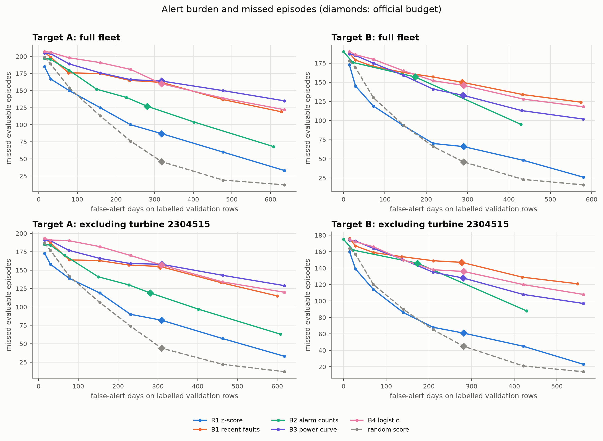

# Validation alert-burden analysis

Generated by `scripts/analyse_alert_budgets.py` (D-054). Models and their selected settings stay fixed; each budget chooses its own threshold on validation. The official budget remains 1 false alarm per turbine-month. No test scores are used.

## R1 versus the random floor

R1 is the strongest available model by validation PR-AUC. This table compares episode recall with random scores at the same allowed budget; it does not select the best model or budget for deployment.

| Target | Allowed budget | R1 false-alert days | R1 detected / evaluable episodes | R1 missed episodes | R1 recall | Random recall | Recall difference |
|---|---:|---:|---:|---:|---:|---:|---:|
| A | 0.05 | 15 | 24 / 209 | 185 | 0.115 | 0.048 | +0.067 |
| A | 0.1 | 31 | 42 / 209 | 167 | 0.201 | 0.096 | +0.105 |
| A | 0.25 | 79 | 59 / 209 | 150 | 0.282 | 0.263 | +0.019 |
| A | 0.5 | 159 | 84 / 209 | 125 | 0.402 | 0.459 | -0.057 |
| A | 0.75 | 238 | 109 / 209 | 100 | 0.522 | 0.636 | -0.115 |
| A | 1 | 318 | 122 / 209 | 87 | 0.584 | 0.780 | -0.196 |
| A | 1.5 | 477 | 149 / 209 | 60 | 0.713 | 0.909 | -0.196 |
| A | 2 | 636 | 176 / 209 | 33 | 0.842 | 0.943 | -0.100 |
| B | 0.05 | 14 | 19 / 192 | 173 | 0.099 | 0.073 | +0.026 |
| B | 0.1 | 29 | 47 / 192 | 145 | 0.245 | 0.120 | +0.125 |
| B | 0.25 | 72 | 73 / 192 | 119 | 0.380 | 0.323 | +0.057 |
| B | 0.5 | 143 | 98 / 192 | 94 | 0.510 | 0.510 | +0.000 |
| B | 0.75 | 217 | 122 / 192 | 70 | 0.635 | 0.656 | -0.021 |
| B | 1 | 290 | 126 / 192 | 66 | 0.656 | 0.760 | -0.104 |
| B | 1.5 | 435 | 144 / 192 | 48 | 0.750 | 0.880 | -0.130 |
| B | 2 | 580 | 166 / 192 | 26 | 0.865 | 0.917 | -0.052 |

## Fleet sensitivity

- A, all: R1 exceeds the random recall point estimate at these sampled budgets: 0.05, 0.1, 0.25.
- A, excl_2304515: R1 exceeds the random recall point estimate at these sampled budgets: 0.05, 0.1, 0.25.
- B, all: R1 exceeds the random recall point estimate at these sampled budgets: 0.05, 0.1, 0.25.
- B, excl_2304515: R1 exceeds the random recall point estimate at these sampled budgets: 0.05, 0.1, 0.25, 0.5.

## Reading the cost trade-off

`tables/alert_budget_validation.csv` contains every available T0 model, both targets, both fleet variants and every configured budget, including constant/random floors. It records realised rates, labelled alert days, false-alert days, missed episodes, lead time, prevalence and episode counts. `tables/alert_budget_inputs.json` records SHA-256 hashes of the protocol and input files.

False-alert days count alerts on negative labelled days. A turbine-month equals the configured days-per-month amount of labelled turbine-days, not full calendar exposure. Total alert days also include positive labelled days, but exclude unlabelled days. Repeated alerts may refer to one episode; there is no cooldown. These counts are operational burden proxies, not maintenance visits, prevented failures or monetary costs.

Higher budgets generally detect more episodes while allowing more false-alert days. Tied counts can leave part of the budget unused. Random alerts can cover more distinct episode windows than clustered model alerts, especially with a long prediction window and high prevalence. This helps explain the strong random floor.

These are descriptive validation point estimates. Model selection and threshold selection use the same validation period; the sweep adds no uncertainty intervals or significance claims. Official-budget turbine-bootstrap intervals remain in T0. Actual maintenance and missed-event costs are unavailable, so no economic optimum is claimed. R2 and main LightGBM remain pending; rerun after they are registered.



## Reproduce

```powershell
.venv/Scripts/python.exe scripts/make_baseline_table.py
.venv/Scripts/python.exe scripts/analyse_alert_budgets.py
.venv/Scripts/python.exe scripts/make_report_figures.py --only F15 F27
```
