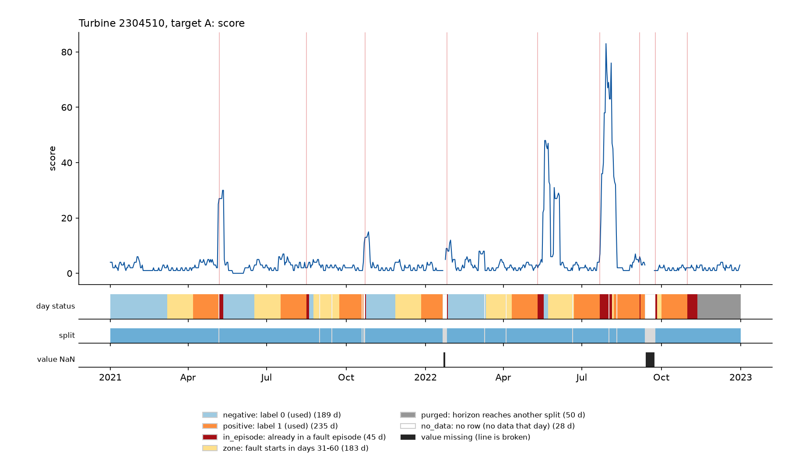
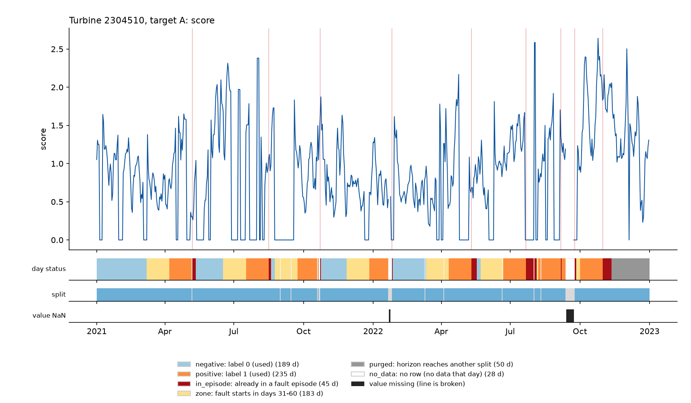

# Farhan: B2, R1 and T0 validation results

B2 and R1 are implemented and evaluated. T0 includes all currently available registered models: B1 (including its two simple variants), B2, R1 and Revael B4, plus both floors. B3 and R2 are pending teammate implementations; the R1/R2 overlay and final team Gate G2 comparison remain pending. No test-year scoring was performed.

## Results

PR-AUC measures ranking of labelled days. Recall here is the share of evaluable episodes detected at the configured false-alarm budget; these are different measurements. Intervals below are the shared runner bootstrap intervals. They do not correct for validation model selection.

| Target | Model | PR-AUC (interval) | Episode recall (interval) | Lead days | False alarms / turbine-month | Episodes | Prevalence |
|---|---|---|---|---|---|---|---|
| A | B0a_constant | 0.470 (0.411–0.538) | 0.000 (0.000–0.000) | nan | 0.000 | 209 | 0.470 |
| A | B0b_random | 0.465 (0.404–0.535) | 0.780 (0.722–0.842) | 20 | 0.999 | 209 | 0.470 |
| A | B1_recent_fault | 0.559 (0.482–0.647) | 0.225 (0.177–0.273) | 27 | 0.999 | 209 | 0.470 |
| A | B1_fault_count | 0.533 (0.467–0.612) | 0.163 (0.123–0.203) | 28 | 0.499 | 209 | 0.470 |
| A | B1_fault_recency | 0.528 (0.457–0.600) | 0.388 (0.312–0.458) | 21 | 0.807 | 209 | 0.470 |
| A | B2_alarm_count | 0.517 (0.453–0.584) | 0.392 (0.329–0.453) | 21.5 | 0.883 | 209 | 0.470 |
| A | R1_zscore | 0.577 (0.530–0.628) | 0.584 (0.510–0.660) | 21.5 | 0.999 | 209 | 0.470 |
| A | B4_logistic | 0.447 (0.377–0.553) | 0.234 (0.168–0.315) | 18 | 0.999 | 209 | 0.470 |
| B | B0a_constant | 0.492 (0.429–0.562) | 0.000 (0.000–0.000) | nan | 0.000 | 192 | 0.492 |
| B | B0b_random | 0.483 (0.419–0.557) | 0.760 (0.703–0.815) | 21 | 1.000 | 192 | 0.492 |
| B | B1_recent_fault | 0.550 (0.462–0.655) | 0.219 (0.147–0.299) | 27.5 | 0.990 | 192 | 0.492 |
| B | B1_fault_count | 0.530 (0.456–0.623) | 0.193 (0.130–0.255) | 28 | 0.972 | 192 | 0.492 |
| B | B1_fault_recency | 0.531 (0.459–0.618) | 0.359 (0.260–0.463) | 16 | 0.972 | 192 | 0.492 |
| B | B2_alarm_count | 0.511 (0.442–0.586) | 0.182 (0.128–0.243) | 13 | 0.597 | 192 | 0.492 |
| B | R1_zscore | 0.588 (0.535–0.652) | 0.656 (0.589–0.723) | 20 | 1.000 | 192 | 0.492 |
| B | B4_logistic | 0.451 (0.372–0.532) | 0.240 (0.160–0.332) | 20 | 1.000 | 192 | 0.492 |

R1 ranks best by PR-AUC: A 0.577 versus random 0.465 (+0.112), B 0.588 versus 0.483 (+0.105). B1 and selected B2 also exceed the random PR-AUC point estimate; B4 does not. None of the non-random baselines exceeds random episode recall. R1 reaches 58.4% versus 78.0% for A and 65.6% versus 76.0% for B. These point-estimate comparisons are not claims of statistical significance.

Excluding turbine 2304515, R1 PR-AUC is 0.565 (A) and 0.576 (B), with recall 57.9% and 65.5%. Random recall remains 77.4% and 74.6%. The conclusion persists. Full intervals, thresholds, detection counts and random-floor differences are in `tables/t0_validation.csv`; the two fleet versions are also saved separately.

## B2: alarm counts

All 15 variants are reported in `tables/b2_tuning.csv`. Validation PR-AUC selected tier 1+2 for A (0.517) and code 10105 for B (0.511). This is per-target selection, stored in the protocol. Candidate order resolves exact PR-AUC ties. Counts retain ties: no added noise, and some constant/rare-code variants produce zero recall under the strict threshold budget. Missing or nonfinite count inputs contribute zero.

Monthly means use all available validation feature days, not just labelled days (`tables/b2_monthly_counts.csv`). Total counts range from about 126 per trailing seven days in February 2022 to 1,286 in July 2021. Tier 2 ranges from 0.013 in March 2021 to 8.288 in August 2022; code 10105 ranges from 0.090 in January 2022 to 1.160 in August 2022. This strong month-to-month variation is consistent with weather/season effects, but two years and changing coverage cannot isolate their cause.

Codes 20 and 25 each fall from about 305 average trailing-seven-day counts in 2021 to 128 in 2022 (about 58% lower). Total-count comparisons therefore contain a substantial recording/coverage or population shift and should not be interpreted solely as changing failure risk.



## R1: healthy temperature reference

Parvez H0 selects healthy negatives using the complete training label history, quality flags and seven-day recovery exclusion. Only the R1 fitting copy receives the training mask. Scoring reads the configured seven sensor features and turbine ID only. Means and population standard deviations come from healthy daily operating values, then score the causal seven-day mean. The final score is the largest absolute sensor z-score.

Each sensor needs 30 healthy observations and standard deviation above 1e-6. Otherwise it uses pooled healthy-training moments; unseen turbines use the same pooled reference. Unusable pooled sensors are disabled; missing values are skipped, all-missing scores become zero. A wholly unusable reference fails explicitly. All 147 full-fleet turbine/sensor references per target used local moments in this run. Exact counts, moments and fallback sources are in `tables/r1_parameters.csv`. R1 intentionally ignores wind/load; R2 must be compared when available.



Both timelines were visually checked. Blank calendar days retain the shared status strips. Zero R1 values may be the all-missing fallback, not proof of normal operation.

## Reproduction and code map

Run from the repository root with the prepared feature/label parquets:

```powershell
.venv/Scripts/python.exe scripts/tune_b2_alarm_count.py
.venv/Scripts/python.exe scripts/tune_b4_logistic.py --target both
# Review printed selections against configs/protocol.yaml before running T0.
.venv/Scripts/python.exe scripts/make_baseline_table.py
.venv/Scripts/python.exe -m pytest -q
.venv/Scripts/python.exe -m ruff check .
```

Tuning scripts report choices; they do not silently rewrite the protocol. B4 selected C=0.01 for both targets. Its full grid and coefficients are retained in the b4 tables.

- B2 implementation: `src/wt_predmaint/models/alarm.py`.
- R1 implementation: `src/wt_predmaint/models/zscore.py`.
- Healthy-row dependency: `src/wt_predmaint/models/healthy.py` and `scripts/report_healthy_rows.py` from Parvez commit 889a90c.
- Runner integration: `src/wt_predmaint/evaluation/runner.py` and `models/registry.py`.
- Synthetic verification: `tests/test_farhan_models.py`, plus imported H0/P0/B4 tests.
- Decisions and settings: D-051–D-053 in `docs/DECISIONS.md` and `configs/protocol.yaml`.

138 tests passed; ruff passed. Scikit-learn emits a non-failing deprecation warning for the imported B4 penalty argument. Existing causal features were reused without changing feature construction. Raw data and test scores are not committed. High prevalence, autocorrelated days, overlapping episode horizons, and related A/B labels limit interpretation; validation-selected performance is not an unbiased held-out estimate.
