# Report figures

Generated by `scripts/make_report_figures.py` (D-025); do not edit by hand.
Every figure is a registered function in `src/wt_predmaint/reporting/`.
Model results use validation years only: the test years (2023 to 2026-04) are scored
once for frozen configurations. Colours follow the project palette: target A is blue
and target B is orange wherever both appear.

| ID | Figure | Report section | File |
|---|---|---|---|
| F01 | Data coverage by turbine and month | Data and cleaning | [01_data/F01_coverage_turbine_month.png](01_data/F01_coverage_turbine_month.png) |
| F02 | What the cleaning layer touched, by year | Data and cleaning | [01_data/F02_cleaning_by_year.png](01_data/F02_cleaning_by_year.png) |
| F03 | Why alarm codes are not the prediction target | Data and cleaning, target choice | [01_data/F03_alarm_window_rates.png](01_data/F03_alarm_window_rates.png) |
| F04 | Tier 1 alarms behave like routine operation | Data and cleaning, target choice | [01_data/F04_alarm_schedule_and_season.png](01_data/F04_alarm_schedule_and_season.png) |
| F05 | Daily fault time and the 4-hour fault-day threshold | Targets and labels | [02_labels/F05_timeerr_distribution.png](02_labels/F05_timeerr_distribution.png) |
| F06 | Fault episodes per turbine and year | Targets and labels | [02_labels/F06_episodes_per_turbine_year.png](02_labels/F06_episodes_per_turbine_year.png) |
| F07 | Do the two fault definitions find the same events? | Targets and labels | [02_labels/F07_target_agreement.png](02_labels/F07_target_agreement.png) |
| F08 | How a turbine-day is labelled | Targets and labels | [02_labels/F08_label_geometry.png](02_labels/F08_label_geometry.png) |
| F09 | Which days are kept, and why the others are dropped | Targets and labels | [02_labels/F09_label_status_by_split.png](02_labels/F09_label_status_by_split.png) |
| F10 | Positive rate by year and by turbine | Targets and labels | [02_labels/F10_positive_rate_year_turbine.png](02_labels/F10_positive_rate_year_turbine.png) |
| F11 | What the 366 model features are made of | Features | [03_features/F11_feature_groups.png](03_features/F11_feature_groups.png) |
| F12 | Which sensors exist in which years | Features | [03_features/F12_sensor_availability_by_year.png](03_features/F12_sensor_availability_by_year.png) |
| F13 | How the turbines spend their time | Features | [03_features/F13_operating_state.png](03_features/F13_operating_state.png) |
| F14 | Healthy training rows by year | Features, normal behaviour | [03_features/F14_healthy_rows_by_year.png](03_features/F14_healthy_rows_by_year.png) |
| F15 | Episode recall as the false-alarm budget changes | Evaluation | [04_evaluation/F15_recall_vs_false_alarm_budget.png](04_evaluation/F15_recall_vs_false_alarm_budget.png) |
| F16 | Precision-recall curves on validation | Evaluation | [04_evaluation/F16_precision_recall_curves.png](04_evaluation/F16_precision_recall_curves.png) |
| F17 | PR-AUC of every baseline against the random score | Baselines | [05_baselines/F17_pr_auc_comparison.png](05_baselines/F17_pr_auc_comparison.png) |
| F18 | Episode recall at the false-alarm budget | Baselines | [05_baselines/F18_recall_comparison.png](05_baselines/F18_recall_comparison.png) |
| F19 | Median warning time before an episode | Baselines | [05_baselines/F19_lead_time.png](05_baselines/F19_lead_time.png) |
| F20 | Results with and without turbine 2304515 | Baselines | [05_baselines/F20_sensitivity_without_2304515.png](05_baselines/F20_sensitivity_without_2304515.png) |
| F21 | B3: the learned healthy wind-speed to rotor-speed curve | Baselines | [05_baselines/F21_b3_power_curve.png](05_baselines/F21_b3_power_curve.png) |
| F22 | B4: largest standardised logistic coefficients | Baselines | [05_baselines/F22_b4_coefficients.png](05_baselines/F22_b4_coefficients.png) |
| F23 | B2: alarm counts move with the season and with a 2022 shift | Baselines | [05_baselines/F23_b2_alarm_seasonality.png](05_baselines/F23_b2_alarm_seasonality.png) |
| F24 | R1: healthy temperature references per turbine | Baselines | [05_baselines/F24_r1_healthy_reference.png](05_baselines/F24_r1_healthy_reference.png) |
| F25 | Do baseline scores separate positive from negative days? | Baselines | [05_baselines/F25_score_separation.png](05_baselines/F25_score_separation.png) |
| F26a | Risk timeline for one turbine: R1 z-score | Baselines | [05_baselines/F26a_timeline_R1_zscore.png](05_baselines/F26a_timeline_R1_zscore.png) |
| F26b | Risk timeline for one turbine: B1 recent faults | Baselines | [05_baselines/F26b_timeline_B1_recent_fault.png](05_baselines/F26b_timeline_B1_recent_fault.png) |
| F26c | Risk timeline for one turbine: B2 alarm counts | Baselines | [05_baselines/F26c_timeline_B2_alarm_count.png](05_baselines/F26c_timeline_B2_alarm_count.png) |
| F26d | Risk timeline for one turbine: B3 power curve | Baselines | [05_baselines/F26d_timeline_B3_power_curve.png](05_baselines/F26d_timeline_B3_power_curve.png) |
| F26e | Risk timeline for one turbine: B4 logistic | Baselines | [05_baselines/F26e_timeline_B4_logistic.png](05_baselines/F26e_timeline_B4_logistic.png) |
| F27 | False-alert days versus missed episodes | Evaluation | [04_evaluation/F27_alert_burden_vs_missed_episodes.png](04_evaluation/F27_alert_burden_vs_missed_episodes.png) |
| F32 | NBM: fit quality and validation-year shift per sensor | O1 degradation indicator | [06_nbm/F32_nbm_validation_shift.png](06_nbm/F32_nbm_validation_shift.png) |
| F33 | NBM indicator against time to the next episode | O1 degradation indicator | [06_nbm/F33_nbm_indicator_vs_lead.png](06_nbm/F33_nbm_indicator_vs_lead.png) |
| F34 | SHAP: what the frozen LightGBM relies on | Explainability | [07_explain_robustness/F34_shap_top_features.png](07_explain_robustness/F34_shap_top_features.png) |
| F35 | Robustness: sensor-group dropout and leave-one-turbine-out | Robustness | [07_explain_robustness/F35_robustness_dropout_loto.png](07_explain_robustness/F35_robustness_dropout_loto.png) |
| F36 | From validation to test: no ranking carried over | Results | [08_exploratory/F36_validation_to_test_shift.png](08_exploratory/F36_validation_to_test_shift.png) |
| F37 | Pruning the features: fewer columns, same score | Exploratory rounds | [08_exploratory/F37_feature_pruning.png](08_exploratory/F37_feature_pruning.png) |
| F38 | Other label definitions: only simple rules move | Exploratory rounds | [08_exploratory/F38_label_sensitivity.png](08_exploratory/F38_label_sensitivity.png) |
| F39 | Ranking the turbines each day: the power-curve baseline leads | Exploratory rounds | [08_exploratory/F39_turbine_ranking.png](08_exploratory/F39_turbine_ranking.png) |

## F01: Data coverage by turbine and month

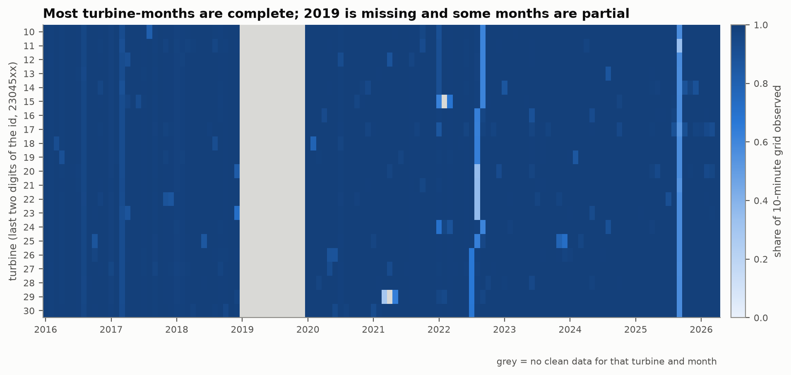

- **Takeaway:** Turbines are almost fully observed; the exceptions are 2019, which has no clean temperature and pressure data, and a few months when many turbines are partial at once (for example mid-2022 and September 2025).
- **Report section:** Data and cleaning
- **Built from:** data/interim/clean/scada_*.parquet; reporting/context.py coverage
- **Read with:** Share of the full 10-minute grid after the three SCADA tables are joined; months below 0.9 are flagged as outage months (D-015).

## F02: What the cleaning layer touched, by year

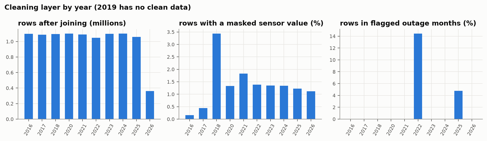

- **Takeaway:** Cleaning flags and masks a small share of rows and never drops months: at most 3.5% of rows have a masked value (peak in 2018), and flagged outage months cover 2022 and 2025 only.
- **Report section:** Data and cleaning
- **Built from:** reports/tables/cleaning_report.csv (scripts/build_clean_data.py)
- **Read with:** Exact duplicates were removed; flags are kept in the data (D-014, D-015).

## F03: Why alarm codes are not the prediction target

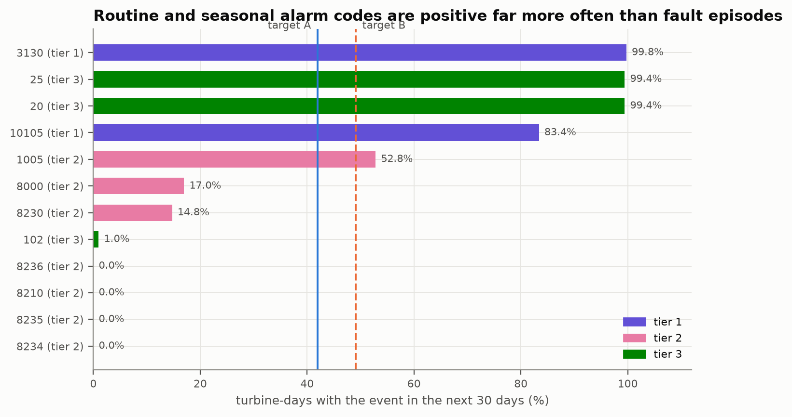

- **Takeaway:** Several alarm codes fire in almost every 30-day window, so predicting them would be trivial; the fault episodes (A, B) are positive in a more balanced share of windows.
- **Report section:** Data and cleaning, target choice
- **Built from:** data/interim/alarm_events.parquet, data/interim/labels/*_labels.parquet
- **Read with:** Share of turbine-days with at least one event of the code in the next 30 days, over all candidate days of the three splits (no exclusions applied); the target rates are over labelled rows.

## F04: Tier 1 alarms behave like routine operation

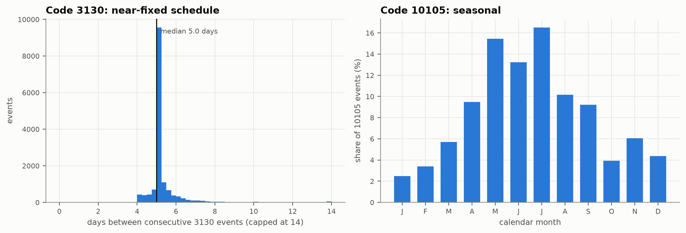

- **Takeaway:** Pitch-lubrication alarm 3130 recurs on a near-fixed schedule, and cable-untwisting alarm 10105 follows the season, so neither signals component wear.
- **Report section:** Data and cleaning, target choice
- **Built from:** data/interim/alarm_events.parquet
- **Read with:** Documented codes only; gaps are between consecutive 3130 events of one turbine.

## F05: Daily fault time and the 4-hour fault-day threshold

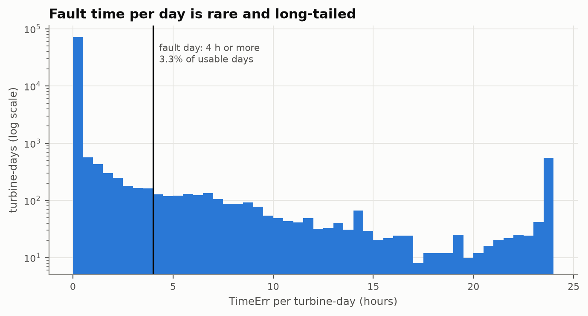

- **Takeaway:** Most days have no fault time; a small tail passes the 4-hour threshold that defines a target A fault day.
- **Report section:** Targets and labels
- **Built from:** data/interim/clean/daily_summary.parquet (tblDailySummary.TimeErr)
- **Read with:** Usable days only (not partial, no impossible hours). TimeErr is undocumented by the provider; its meaning is inferred (D-007, D-008).

## F06: Fault episodes per turbine and year

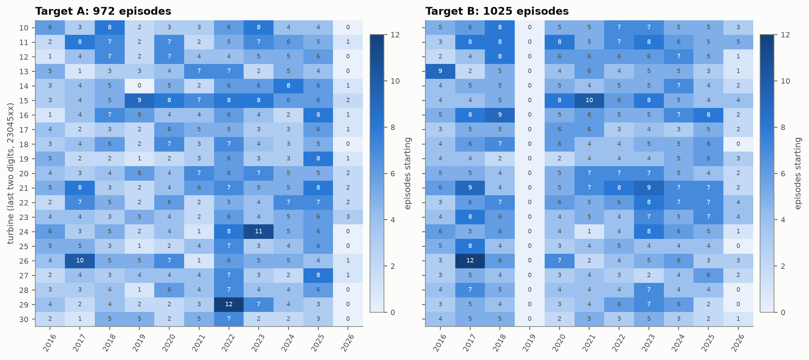

- **Takeaway:** Every turbine has episodes in most years, and turbine 15 (2304515) has more than most. 2019 has target A episodes (from the daily summary) but none for B, which needs the missing 10-minute data.
- **Report section:** Targets and labels
- **Built from:** data/interim/labels/{a,b}_episodes.parquet
- **Read with:** Episodes merge fault days or stop runs less than 7 days apart (D-005, D-007, D-008).

## F07: Do the two fault definitions find the same events?

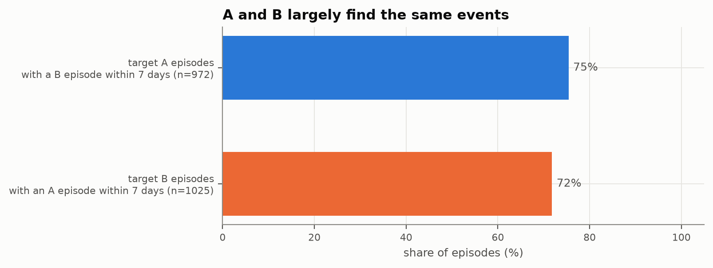

- **Takeaway:** Most episodes found by one definition have a counterpart in the other, so A and B are not independent evidence.
- **Report section:** Targets and labels
- **Built from:** data/interim/labels/{a,b}_episodes.parquet
- **Read with:** Episode-level overlap: an episode matches if the other target has an episode starting within 7 days (the merge gap). Day-level agreement (F1 about 0.8, D-008) is a different measure.

## F08: How a turbine-day is labelled

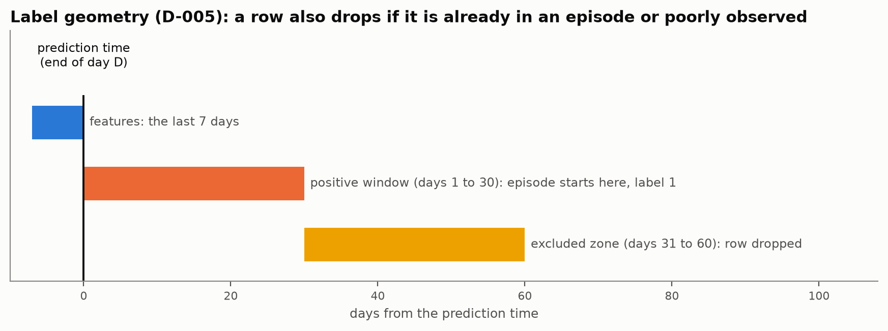

- **Takeaway:** A day is positive if a fault episode starts within 30 days; days 31 to 60 are dropped so the label is not ambiguous; features use only the previous 7 days.
- **Report section:** Targets and labels
- **Built from:** configs/protocol.yaml (labels block); docs/DECISIONS.md D-005, D-019
- **Read with:** Schematic. Day 0 is the end of the prediction day; all lengths come from the protocol.

## F09: Which days are kept, and why the others are dropped

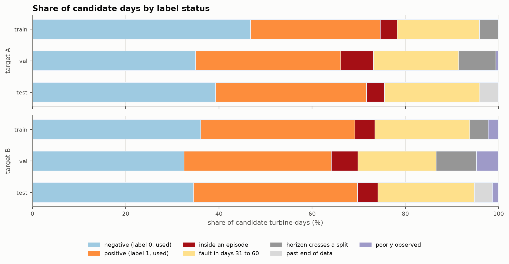

- **Takeaway:** Between about two thirds and three quarters of candidate days carry a label; most of the rest fall in the 31 to 60 day zone, with smaller shares inside episodes or dropped at split boundaries.
- **Report section:** Targets and labels
- **Built from:** reports/tables/label_summary.csv (scripts/build_labels.py)
- **Read with:** Shares are of all candidate turbine-days in each split (D-019).

## F10: Positive rate by year and by turbine

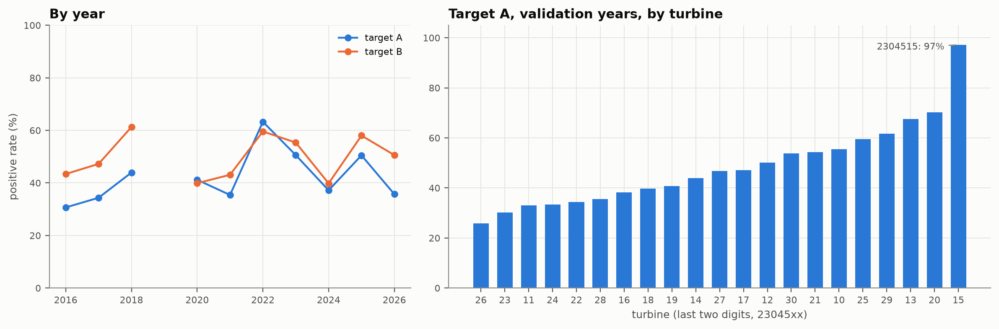

- **Takeaway:** The positive rate is high (37% to 50%) and varies by year; one turbine is positive on almost every validation day, so results are also reported without it.
- **Report section:** Targets and labels
- **Built from:** data/interim/labels/{a,b}_labels.parquet
- **Read with:** Labelled rows only. A prevalence-only score therefore reaches a PR-AUC equal to the positive rate (D-019, D-020).

## F11: What the 366 model features are made of

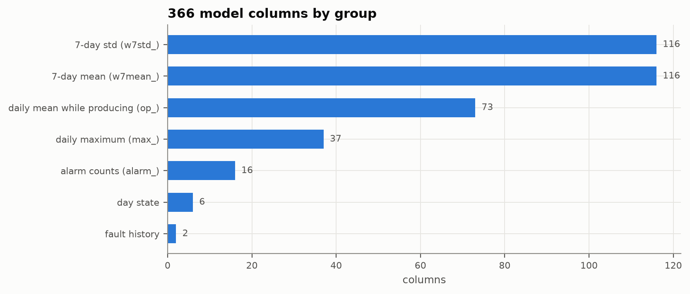

- **Takeaway:** Most features are 7-day means and spreads of daily sensor summaries; alarm counts and fault history add a small number of columns.
- **Report section:** Features
- **Built from:** data/interim/features/daily_features.parquet (features/daily.py)
- **Read with:** D-021.

## F12: Which sensors exist in which years

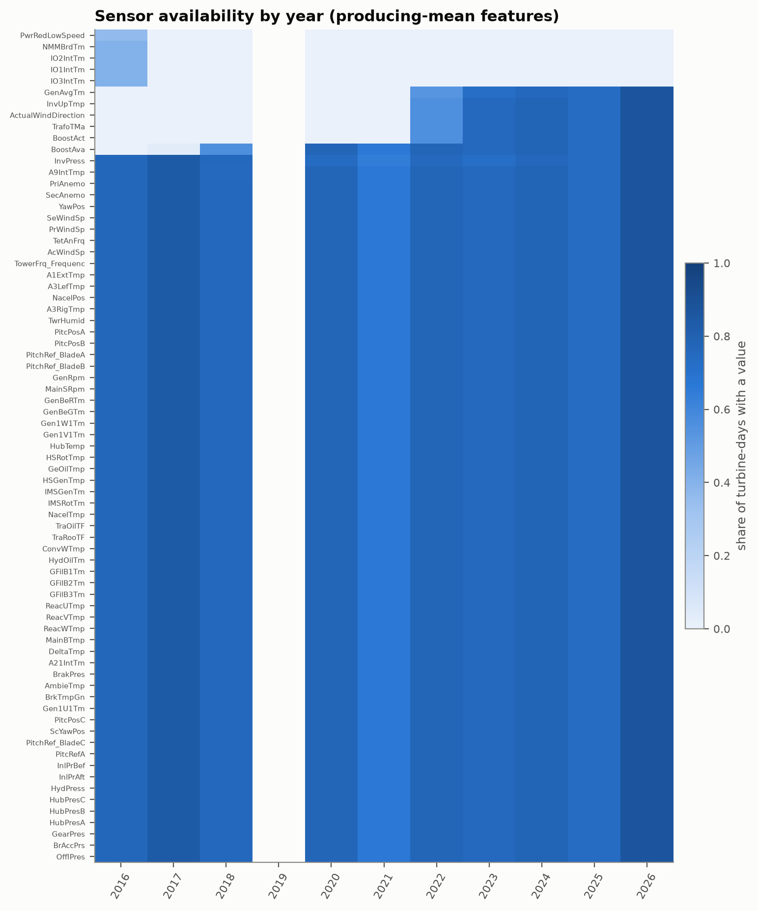

- **Takeaway:** Sensors appear and disappear between years, so some features are mostly missing; columns must be chosen on training years only.
- **Report section:** Features
- **Built from:** data/interim/features/daily_features.parquet
- **Read with:** Share of turbine-days with a value for the daily producing mean; 2019 has no data (D-021).

## F13: How the turbines spend their time

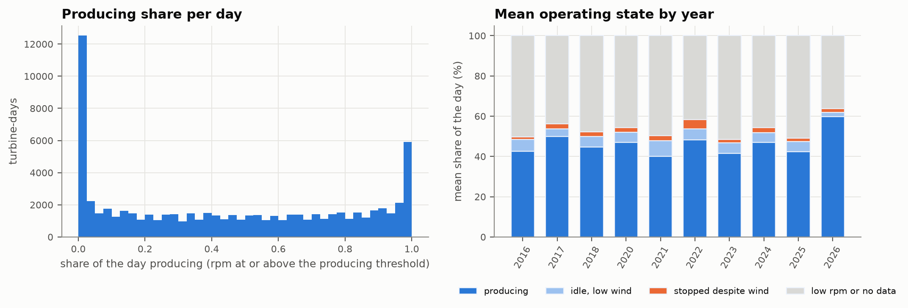

- **Takeaway:** Turbines are producing for roughly 40% to 50% of the time (60% in the partial year 2026), and many days are almost entirely idle or entirely producing, which is why sensor means use producing intervals only.
- **Report section:** Features
- **Built from:** data/interim/features/daily_features.parquet
- **Read with:** Fractions of 10-minute intervals per turbine-day (D-021).

## F14: Healthy training rows by year

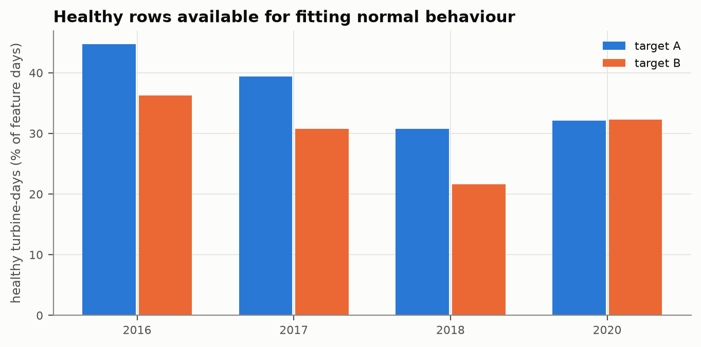

- **Takeaway:** Between about 20% and 45% of training turbine-days qualify as healthy once episodes, a 7-day recovery period and quality flags are excluded; the share is lowest in 2018.
- **Report section:** Features, normal behaviour
- **Built from:** reports/tables/healthy_rows.csv (scripts/report_healthy_rows.py)
- **Read with:** Train years only (D-030); target-specific because the episodes differ.

## F15: Episode recall as the false-alarm budget changes

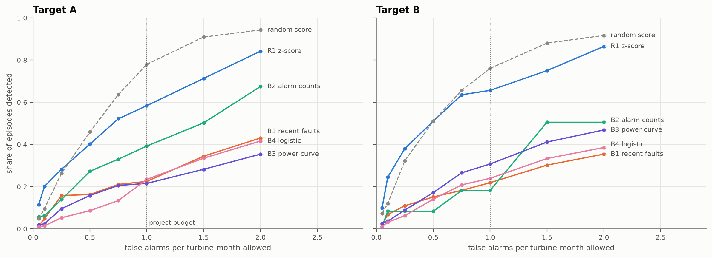

- **Takeaway:** At the project's budget of 1 false alarm per turbine-month a random score detects about three quarters of episodes and every baseline is below it; only R1 is above the random line, and only at the tightest sampled budgets (0.25 per turbine-month or less for both targets); B ties at 0.5.
- **Report section:** Evaluation
- **Built from:** data/interim/scores/*_val.parquet, labels, episodes; evaluation/metrics.py
- **Read with:** Validation years (2021 to 2022) only; thresholds are chosen on validation. Test years are not scored. Each point re-chooses the threshold for its budget on the same validation rows. Real scores alert in streaks on neighbouring days, so the same number of false alarms covers fewer distinct 30-day windows than scattered random alerts (D-009 uses no cooldown).

## F16: Precision-recall curves on validation

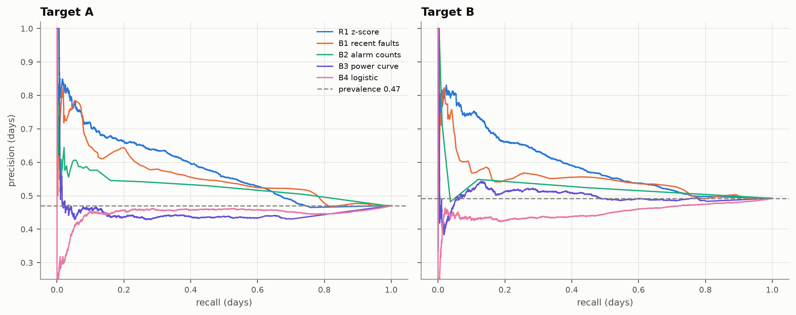

- **Takeaway:** R1 and B1 hold precision of about 0.6 to 0.8 at low recall and fall to the prevalence line as recall grows; B3 and B4 sit at or below it.
- **Report section:** Evaluation
- **Built from:** data/interim/scores/*_val.parquet
- **Read with:** Validation years (2021 to 2022) only; thresholds are chosen on validation. Test years are not scored. Day-level precision and recall, not episode recall.

## F17: PR-AUC of every baseline against the random score

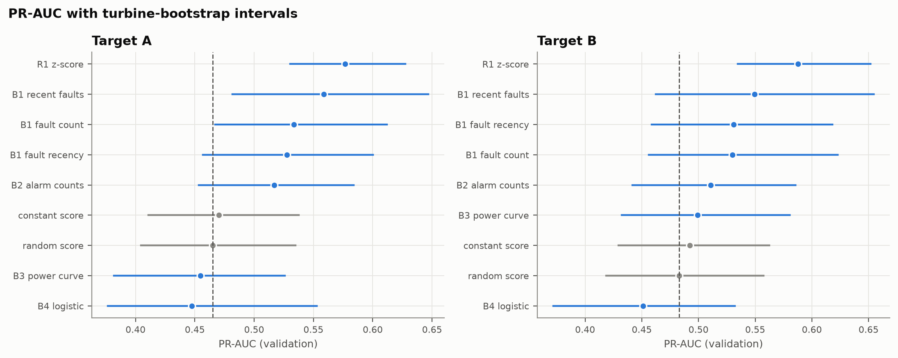

- **Takeaway:** R1 has the highest PR-AUC, followed by the B1 rules and B2; B3 and B4 are at or below the random score. Every interval overlaps the random score's, so differences are small relative to the noise.
- **Report section:** Baselines
- **Built from:** reports/tables/t0_validation.csv (scripts/make_baseline_table.py)
- **Read with:** Validation years (2021 to 2022) only; thresholds are chosen on validation. Test years are not scored. Point = estimate, line = 95% turbine bootstrap interval; the dashed line is the random score. B2's variant was chosen on these data, so its value is optimistic.

## F18: Episode recall at the false-alarm budget

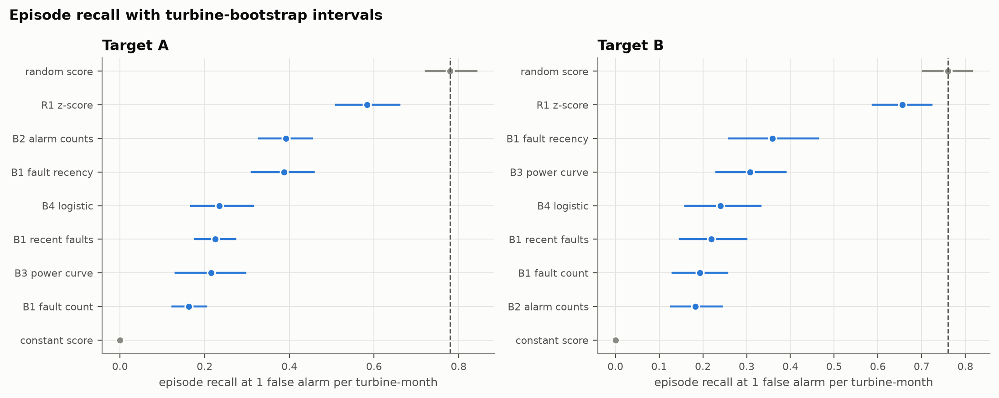

- **Takeaway:** No baseline reaches the random score's recall at 1 false alarm per turbine-month; the random line is the number to beat.
- **Report section:** Baselines
- **Built from:** reports/tables/t0_validation.csv
- **Read with:** Validation years (2021 to 2022) only; thresholds are chosen on validation. Test years are not scored. Recall is the share of evaluable episodes with an alert in the 30 days before.

## F19: Median warning time before an episode

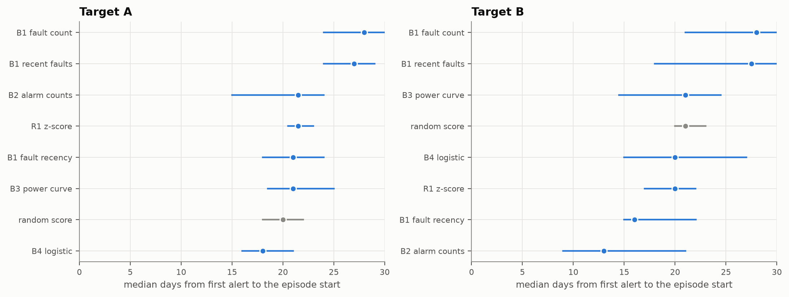

- **Takeaway:** Median warning is roughly two to four weeks for every baseline, but the random score warns about three weeks ahead too, so lead time alone does not show skill.
- **Report section:** Baselines
- **Built from:** reports/tables/t0_validation.csv
- **Read with:** Validation years (2021 to 2022) only; thresholds are chosen on validation. Test years are not scored. Lead time is undefined where nothing is detected.

## F20: Results with and without turbine 2304515

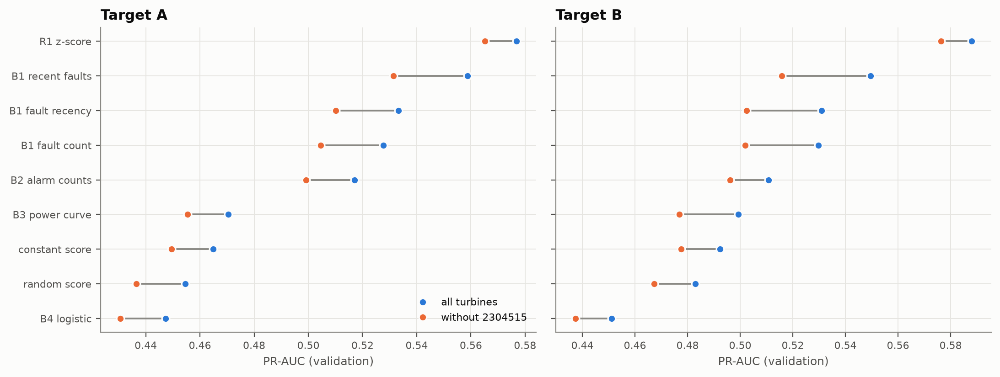

- **Takeaway:** Dropping the outlier turbine lowers every PR-AUC a little but leaves the ranking of baselines unchanged.
- **Report section:** Baselines
- **Built from:** reports/tables/t0_validation.csv
- **Read with:** Validation years (2021 to 2022) only; thresholds are chosen on validation. Test years are not scored. Both variants refit and re-evaluate without the turbine (D-019, D-043).

## F21: B3: the learned healthy wind-speed to rotor-speed curve

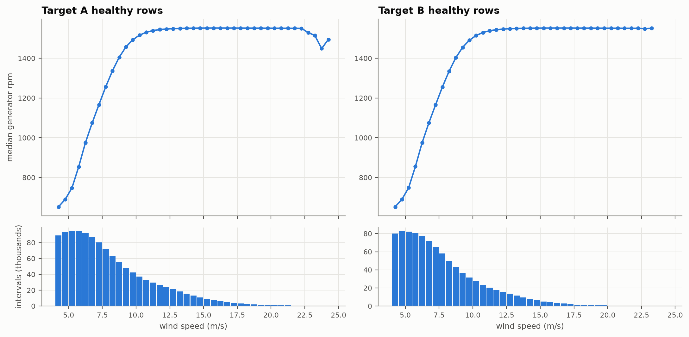

- **Takeaway:** Healthy turbines follow a smooth rotor-speed curve against wind speed; B3 flags days with a persistent shortfall below it.
- **Report section:** Baselines
- **Built from:** reports/tables/b3_curve_{a,b}.csv (models/power_curve.py)
- **Read with:** Pooled over the fleet, fitted on healthy train intervals only (D-031); bins with fewer than 30 intervals are dropped.

## F22: B4: largest standardised logistic coefficients

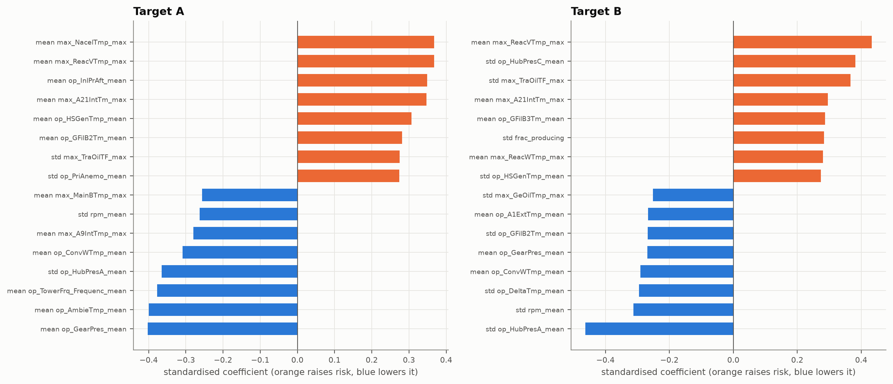

- **Takeaway:** The largest weights sit on temperature, pressure and operating-state window features; they are correlated associations, not causes.
- **Report section:** Baselines
- **Built from:** reports/tables/b4_logistic_coefficients.csv (scripts/tune_b4_logistic.py)
- **Read with:** C = 0.01, standardised inputs; correlated features can split or reverse weights (D-042).

## F23: B2: alarm counts move with the season and with a 2022 shift

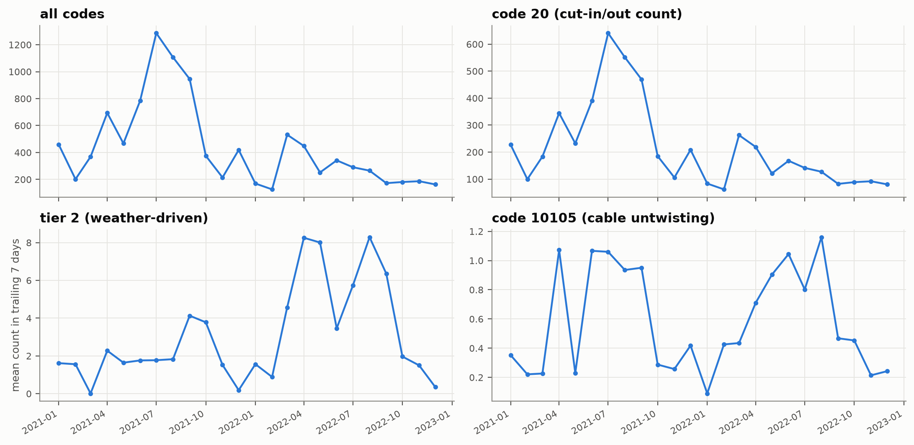

- **Takeaway:** Alarm-count features vary strongly by month and codes 20 and 25 drop sharply in 2022, so B2 partly tracks season and recording changes.
- **Report section:** Baselines
- **Built from:** reports/tables/b2_monthly_counts.csv
- **Read with:** Mean trailing 7-day counts over validation feature days (D-051).

## F24: R1: healthy temperature references per turbine

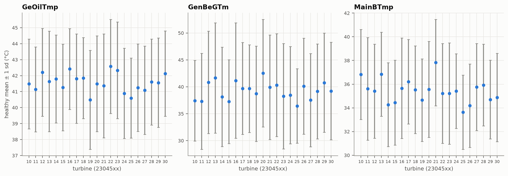

- **Takeaway:** Healthy mean temperatures differ by only about 2 to 6 degrees between turbines, small next to the day-to-day spread (the bars), so a per-turbine reference adds little over a fleet reference.
- **Report section:** Baselines
- **Built from:** reports/tables/r1_parameters.csv (models/zscore.py)
- **Read with:** Mean and standard deviation of the daily producing mean over healthy train days (D-052).

## F25: Do baseline scores separate positive from negative days?

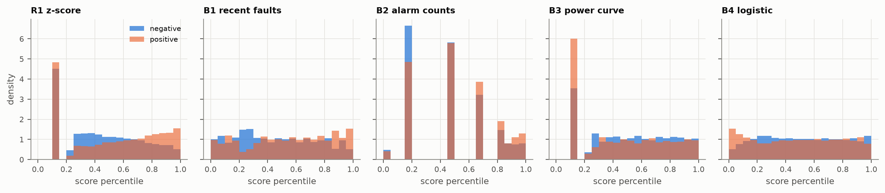

- **Takeaway:** Score distributions of positive and negative days overlap heavily; R1 tilts positives toward higher scores, the others barely separate them.
- **Report section:** Baselines
- **Built from:** data/interim/scores/a_all_*_val.parquet
- **Read with:** Validation years (2021 to 2022) only; thresholds are chosen on validation. Test years are not scored. Target A; percentile ranks within each model. The spike at low ranks for R1 and B3 is the fallback score given to days without usable inputs.

## F26a: Risk timeline for one turbine: R1 z-score

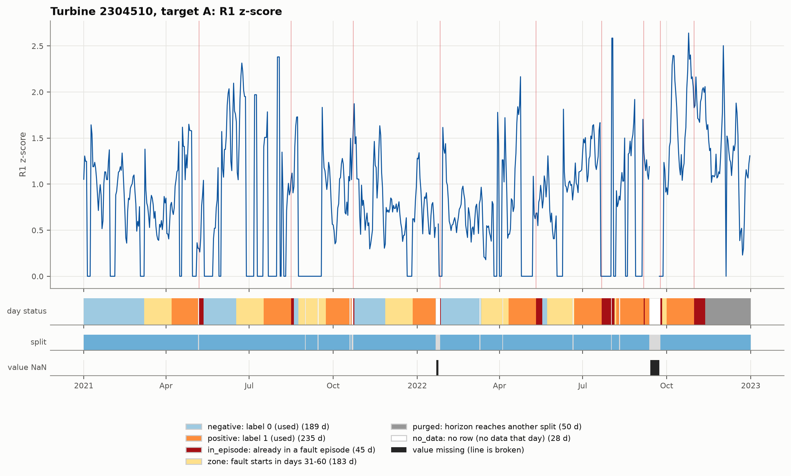

- **Takeaway:** Shows the baseline's score over the validation years with episode starts and the bands that explain every blank day (D-022).
- **Report section:** Baselines
- **Built from:** data/interim/scores/a_all_R1_zscore_val.parquet, labels, episodes; evaluation/plotting.py
- **Read with:** Target A, first turbine in the labels, validation years only. Rule and z-score baselines give days without usable inputs a fallback score, which shows as drops in the line.

## F26b: Risk timeline for one turbine: B1 recent faults

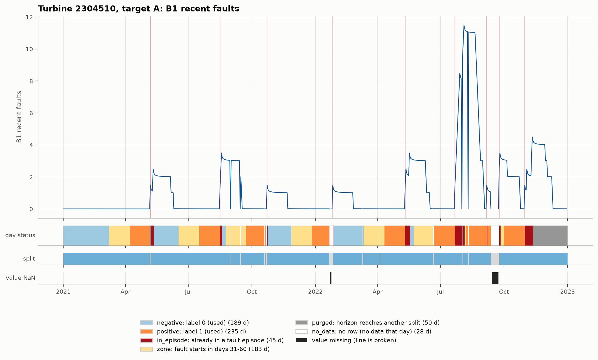

- **Takeaway:** Shows the baseline's score over the validation years with episode starts and the bands that explain every blank day (D-022).
- **Report section:** Baselines
- **Built from:** data/interim/scores/a_all_B1_recent_fault_val.parquet, labels, episodes; evaluation/plotting.py
- **Read with:** Target A, first turbine in the labels, validation years only. Rule and z-score baselines give days without usable inputs a fallback score, which shows as drops in the line.

## F26c: Risk timeline for one turbine: B2 alarm counts

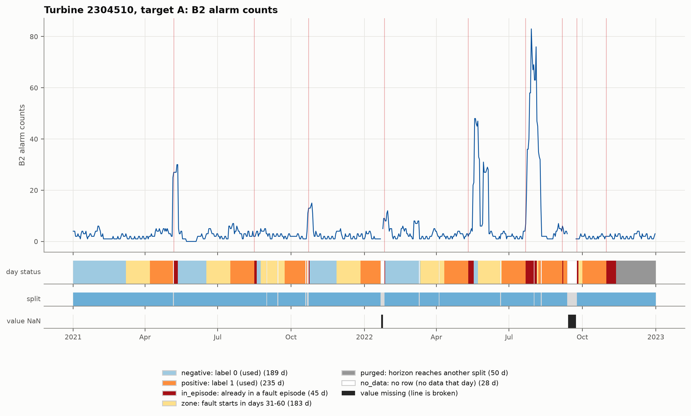

- **Takeaway:** Shows the baseline's score over the validation years with episode starts and the bands that explain every blank day (D-022).
- **Report section:** Baselines
- **Built from:** data/interim/scores/a_all_B2_alarm_count_val.parquet, labels, episodes; evaluation/plotting.py
- **Read with:** Target A, first turbine in the labels, validation years only. Rule and z-score baselines give days without usable inputs a fallback score, which shows as drops in the line.

## F26d: Risk timeline for one turbine: B3 power curve

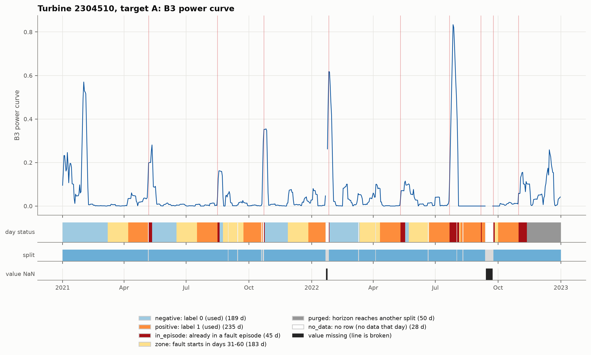

- **Takeaway:** Shows the baseline's score over the validation years with episode starts and the bands that explain every blank day (D-022).
- **Report section:** Baselines
- **Built from:** data/interim/scores/a_all_B3_power_curve_val.parquet, labels, episodes; evaluation/plotting.py
- **Read with:** Target A, first turbine in the labels, validation years only. Rule and z-score baselines give days without usable inputs a fallback score, which shows as drops in the line.

## F26e: Risk timeline for one turbine: B4 logistic

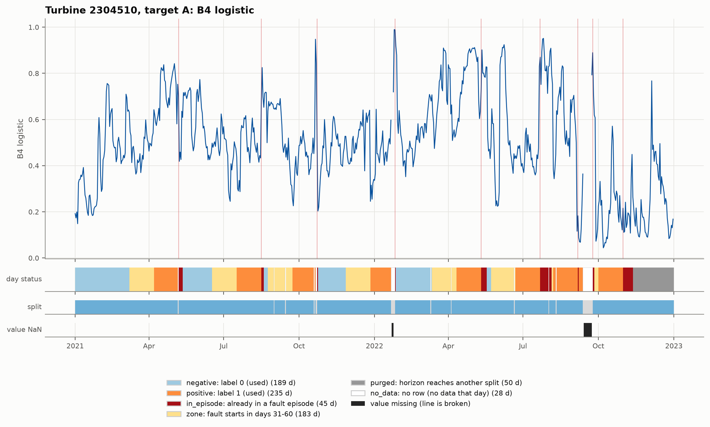

- **Takeaway:** Shows the baseline's score over the validation years with episode starts and the bands that explain every blank day (D-022).
- **Report section:** Baselines
- **Built from:** data/interim/scores/a_all_B4_logistic_val.parquet, labels, episodes; evaluation/plotting.py
- **Read with:** Target A, first turbine in the labels, validation years only. Rule and z-score baselines give days without usable inputs a fallback score, which shows as drops in the line.

## F27: False-alert days versus missed episodes

- **Takeaway:** Each point trades labelled false-alert days against missed evaluable episodes; the full fleet and excluded-turbine panels expose sensitivity to turbine 2304515.
- **Report section:** Evaluation
- **Built from:** reports/tables/alert_budget_validation.csv; scripts/analyse_alert_budgets.py (D-054)
- **Read with:** Validation years (2021 to 2022) only; thresholds are chosen on validation. Test years are not scored. Exploratory point estimates with a threshold per budget. Alert days are not maintenance visits or monetary costs. No cooldown is used.

## F32: NBM: fit quality and validation-year shift per sensor

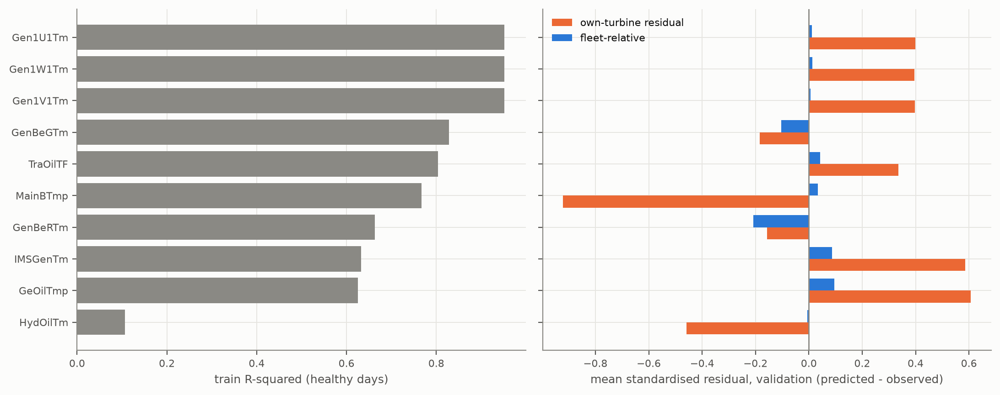

- **Takeaway:** Train R-squared is high for the generator windings and low for hydraulic oil. On healthy-looking validation days the own-turbine residual has a non-zero mean for most sensors (up to about 0.9 standard deviations); subtracting the day's fleet median brings every sensor to within about 0.2.
- **Report section:** O1 degradation indicator
- **Built from:** reports/tables/nbm_fit.csv, nbm_fleet_compare.csv (models/nbm.py, scripts/build_nbm.py)
- **Read with:** Validation years (2021 to 2022) only; models are fitted on healthy train days (2016 to 2020). Mean z of 0 would mean validation days look like the training days; days are negative-labelled and flag-free. The fleet-relative version also removes any fleet-wide change (D-055).

## F33: NBM indicator against time to the next episode

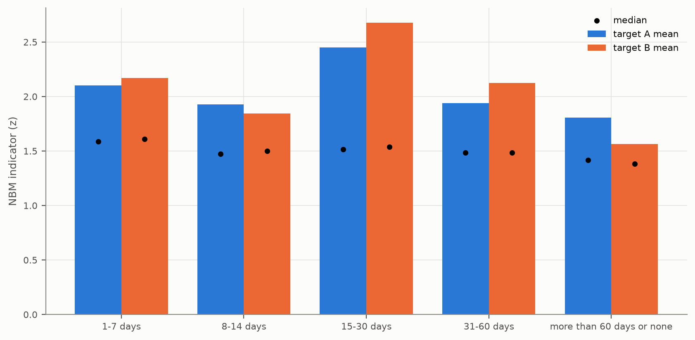

- **Takeaway:** With either residual the indicator is only slightly higher in the windows before an episode than far from one, it does not rise steadily as the episode nears, and the fleet-relative version shrinks the contrast further, so the indicator is a weak early-warning signal on its own.
- **Report section:** O1 degradation indicator
- **Built from:** reports/tables/nbm_lead_variants.csv (models/nbm.py, scripts/build_nbm.py)
- **Read with:** Validation years (2021 to 2022) only; models are fitted on healthy train days (2016 to 2020). Indicator is the largest absolute 7-day smoothed standardised residual over sensors; in-episode days are excluded; turbine-day counts are in the CSV. The two panels use different scales because the fleet-relative residual has a smaller spread.

## F34: SHAP: what the frozen LightGBM relies on

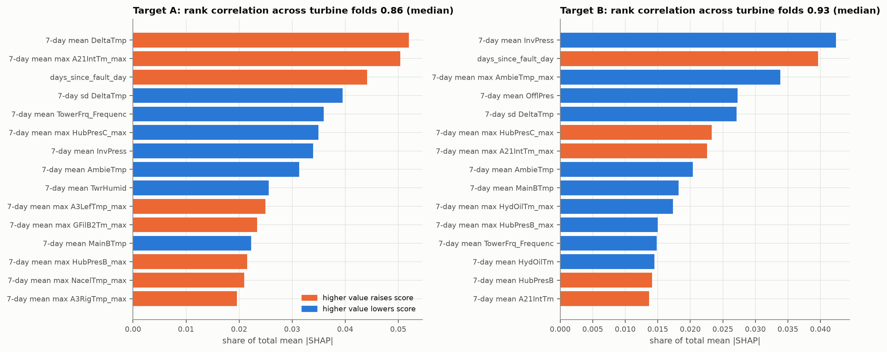

- **Takeaway:** The model leans on ambient and weather-linked inputs (DeltaTmp, ambient temperature, tower humidity and frequency), on pressure sensors (inverter, offline, hub pressure) and on days since the last fault day; component temperatures such as MainBTmp and HydOilTm rank lower. The ranking is stable across leave-one-turbine-out refits.
- **Report section:** Explainability
- **Built from:** reports/tables/shap_importance_a.csv, shap_importance_b.csv, shap_stability.csv (explain/shap_lgbm.py, scripts/run_shap.py)
- **Read with:** Validation years (2021 to 2022) only; frozen L1_lgbm (D-060). Test years are not used. Mean absolute SHAP on 4,000 validation rows. Colour shows the direction of the effect (rank correlation of the feature value with its SHAP value). This describes the model, not causes of faults, and the model scores at the random-score level (D-060).

## F35: Robustness: sensor-group dropout and leave-one-turbine-out

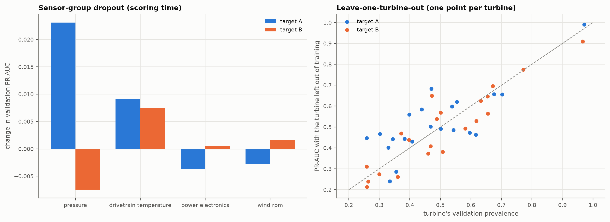

- **Takeaway:** Removing a sensor group barely moves PR-AUC (within 0.03), while recall at the fixed threshold moves only because scores shift and false alarms change; leaving a turbine out of training leaves pooled PR-AUC at or below the pooled prevalence, and per-turbine PR-AUC follows the turbine's own prevalence.
- **Report section:** Robustness
- **Built from:** reports/tables/robustness_dropout.csv, robustness_loto.csv, robustness_loto_summary.csv (evaluation/robustness.py, scripts/run_robustness.py)
- **Read with:** Validation years (2021 to 2022) only; frozen L1_lgbm (D-060). Test years are not used. Dropout sets a group's features to missing at scoring time at the intact model's threshold, so a change in recall comes with a change in false alarms (see the CSV). In the right panel the diagonal is a score no better than the turbine's prevalence; every turbine has at least 113 positive validation rows.

## F36: From validation to test: no ranking carried over

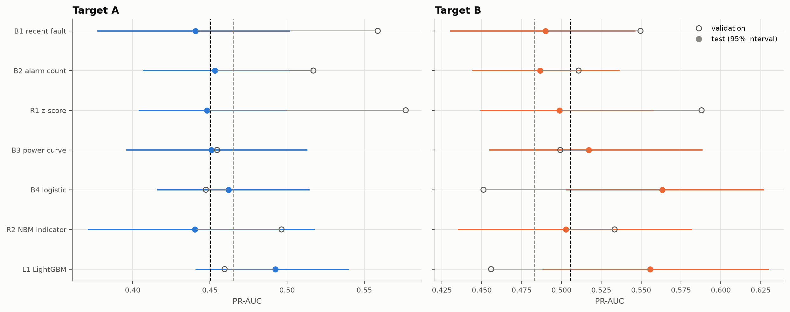

- **Takeaway:** Models that led on the validation years fall back to the random-score value on the test years (R1 most clearly), while the learned models gain a little on test; no test interval excludes the random-score value.
- **Report section:** Results
- **Built from:** reports/tables/baselines_a.csv, baselines_b.csv (scripts/run_baselines.py, frozen run D-061)
- **Read with:** Hollow marker: validation PR-AUC. Filled marker with line: test PR-AUC with its 95% turbine bootstrap interval. Dashed lines: random-score PR-AUC on validation (grey) and test (black). The test years were scored once (D-061).

## F37: Pruning the features: fewer columns, same score

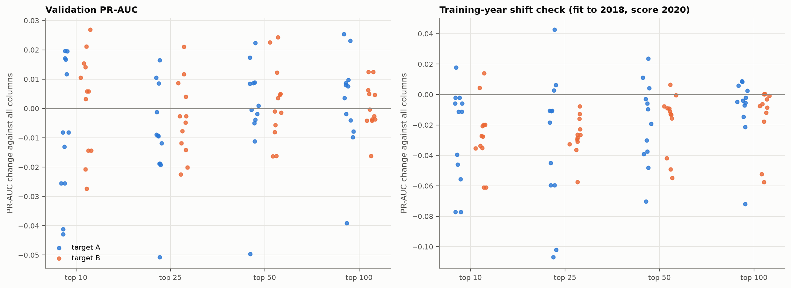

- **Takeaway:** Keeping 50 or 100 columns costs nothing measurable and keeping 10 or 25 does not help; the check on training years gets worse for most pruned versions.
- **Report section:** Exploratory rounds
- **Built from:** reports/tables/exploratory_selection.csv (scripts/run_exploratory.py --round 3, D-066)
- **Read with:** Validation years (2021 to 2022) only; exploratory; the test years are not used. Each point is one pruned configuration minus the same model with all columns (two models, two feature sets, three ranking methods); blue is target A and orange target B. Right panel: the same difference on the training-year shift check (fit to 2018, score 2020).

## F38: Other label definitions: only simple rules move

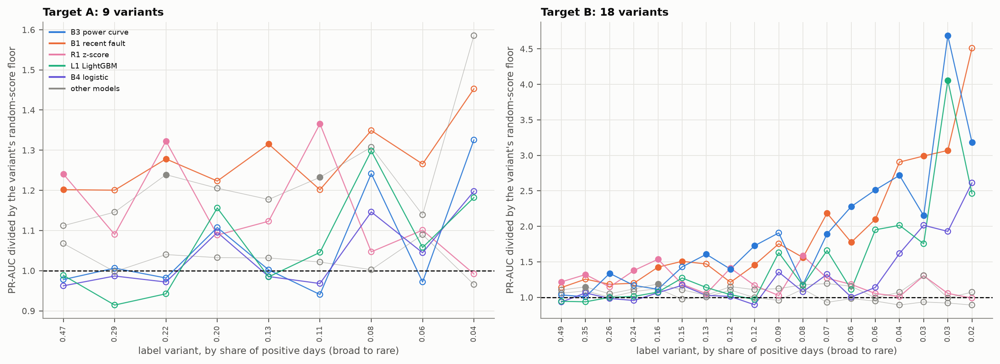

- **Takeaway:** As labels get narrower and rarer, the ratio to the random-score floor rises for most models, but the intervals widen too: almost none of the learned models' (LightGBM, B4) ratios clear their floor, while the simple rules (the power-curve baseline B3, the recent-fault rule B1) do in many variants.
- **Report section:** Exploratory rounds
- **Built from:** reports/tables/label_sensitivity.csv (scripts/run_label_sensitivity.py, D-068)
- **Read with:** Validation years (2021 to 2022) only; exploratory; the test years are not used. Each variant is a different label definition, ordered from the broadest (left) to the rarest (right). The value is PR-AUC divided by that variant's own random-score floor, so 1 means no better than a random score, and a ratio becomes large when the floor is small, so read it with the markers. A filled marker means the 95% interval lies above the floor.

## F39: Ranking the turbines each day: the power-curve baseline leads

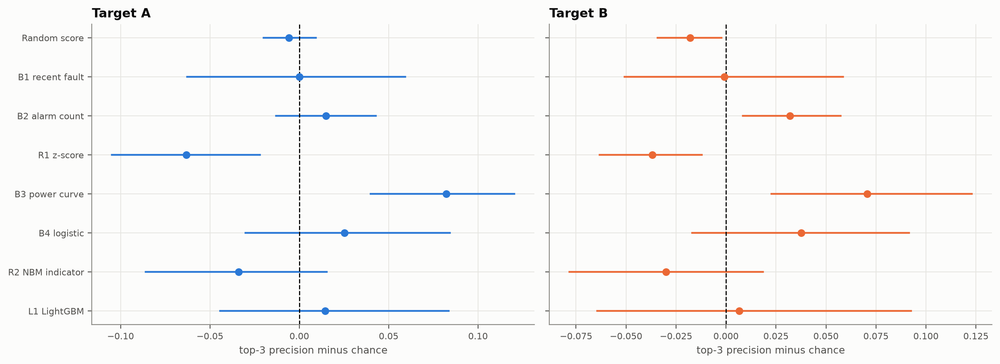

- **Takeaway:** Among the main models, the power-curve baseline B3 puts positive turbines in the daily top three more often than chance for both targets; the z-score R1 does worse than chance.
- **Report section:** Exploratory rounds
- **Built from:** reports/tables/ranking_validation.csv (scripts/run_ranking.py, evaluation/ranking.py, D-065)
- **Read with:** Validation years (2021 to 2022) only; exploratory; the test years are not used. Precision among the three highest-scored turbines each day minus the share of positive turbines that day, with a 95% interval from resampling calendar months. Zero means no better than chance; 92 intervals were examined across the project, so this is a lead to confirm.
