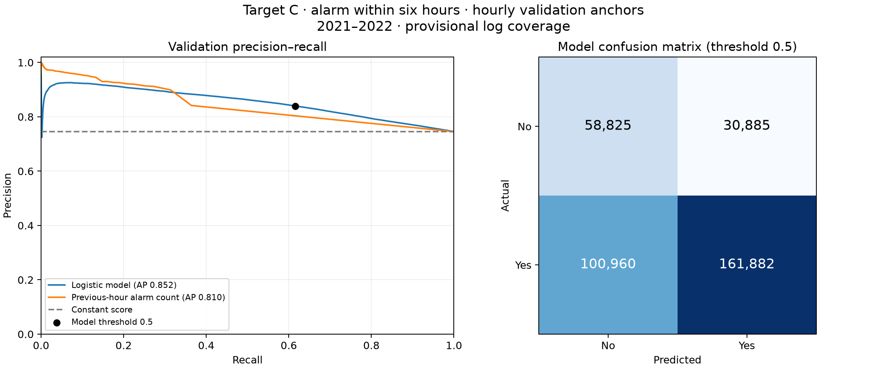

# Target C: local validation performance

**Provisional:** monthly raw alarm exports are assumed complete for represented turbines. Seven fleet-silent days in May 2021 and overlapping windows were excluded. Coverage has not been independently certified.

Prediction question: at each hourly anchor, does any new turbine alarm start in the next six hours? Sensor history uses all available 10-minute observations.

Training: a reproducible uniform sample of **100,000** of **729,996** eligible anchors from 2016–2018 and 2020. There are **730** input features. Validation: all **352,552** eligible anchors from 2021–2022. Test years were not scored.

**Reading:** the model shows ranking signal, but its fixed-threshold yes/no decisions need improvement. Overall accuracy is below always yes. Only **36.8%** of no predictions are correct, and it misses **38.4%** of positive prediction windows. Average precision is a ranking metric, not percent correct.

| Method | Average precision | Precision | Recall | Accuracy | Balanced accuracy |
|---|---:|---:|---:|---:|---:|
| Logistic (threshold 0.5) | 0.852 | 84.0% | 61.6% | 62.6% | 63.6% |
| Alarm in previous hour | 0.810 | 84.2% | 36.4% | 47.5% | 58.2% |
| Always yes | 0.746 | 74.6% | 100.0% | 74.6% | 50.0% |
| Always no | 0.746 | 0.0% | 0.0% | 25.4% | 50.0% |

Validation positive prevalence: **74.6%**. The model's average precision is **1.14×** the constant-score reference.

## Performance by validation year

| Year | Rows | Positive rate | Average precision | Precision | Recall |
|---|---:|---:|---:|---:|---:|
| 2021 | 177,979 | 75.0% | 0.860 | 85.1% | 61.8% |
| 2022 | 174,573 | 74.1% | 0.843 | 82.8% | 61.4% |

## Interpretation limits

These are hourly prediction-point metrics, not event-level detection rates. Six-hour outcome windows overlap and many alarms are repeated, operational or weather related. These scores do not establish mechanical fault prediction.

The threshold is a fixed 0.5 on a class-weighted logistic score, which is not a calibrated probability. No threshold was selected on these validation results. The model was fitted on a training sample, rather than every training anchor.

Complete predictions are in `validation_predictions.parquet`; `validation_predictions.csv` contains only the first 1,000 rows. See `validation_by_station.csv` for turbine-level variation.
